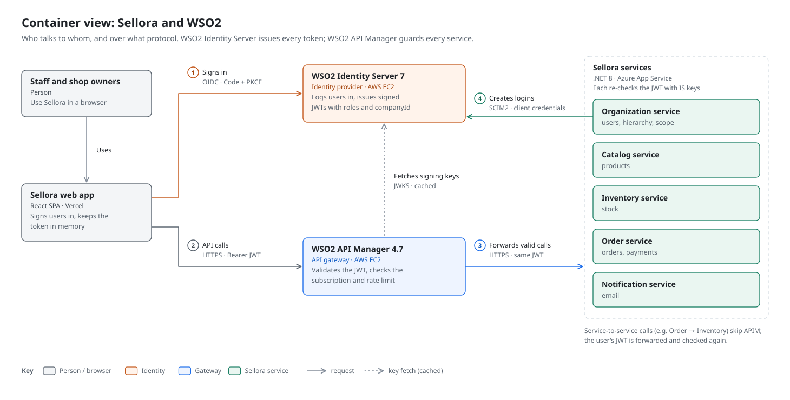
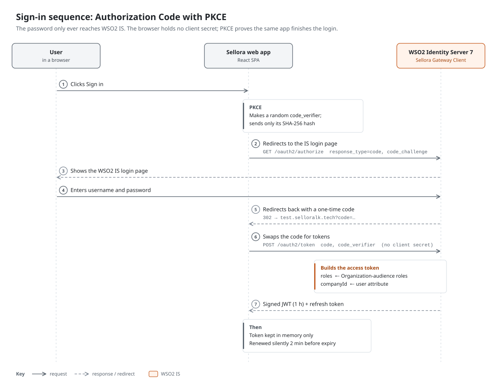
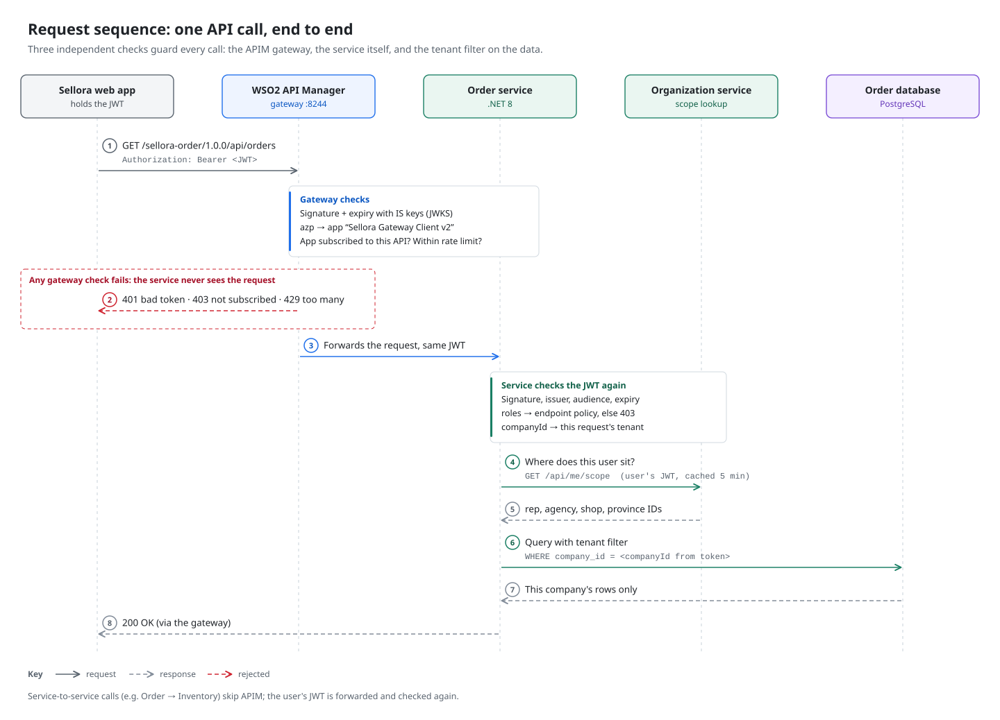
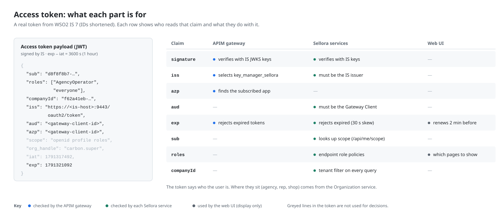
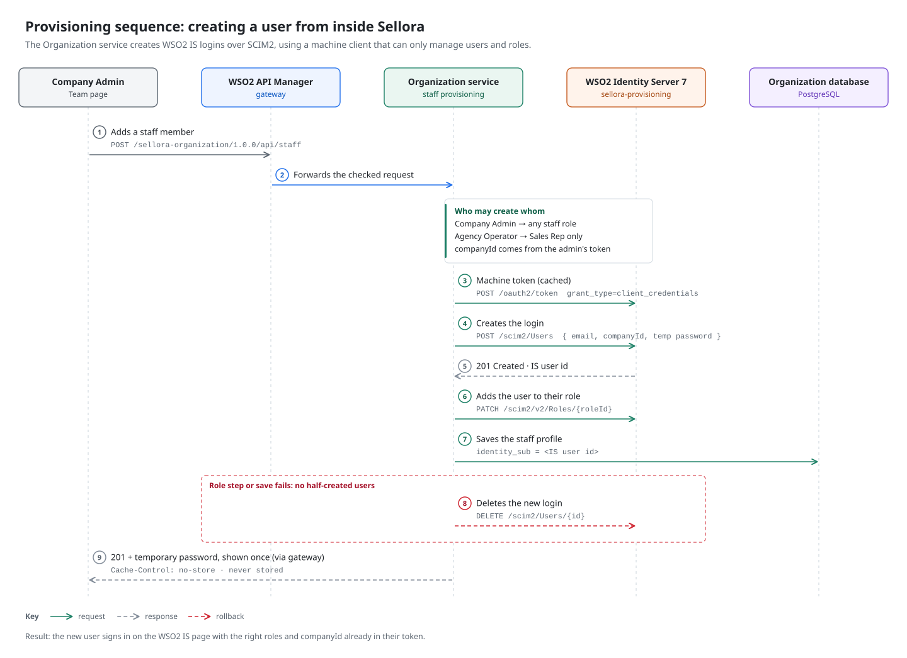
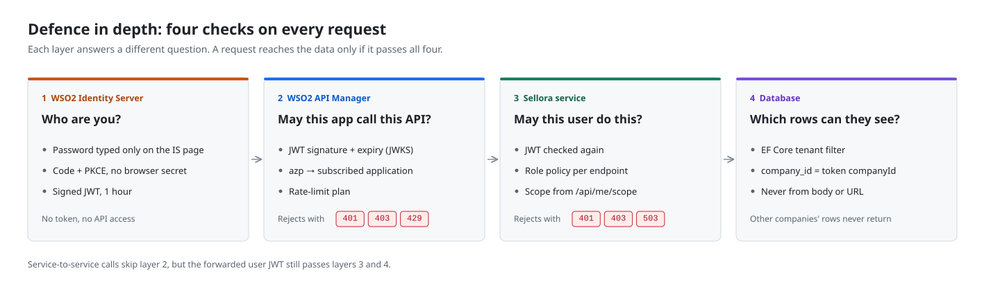
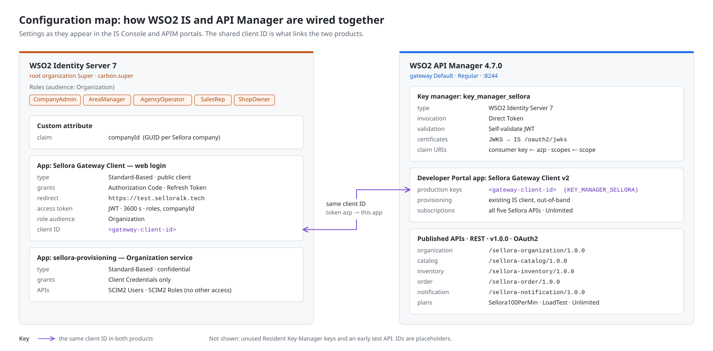

  <picture>
    <source media="(prefers-color-scheme: dark)" srcset="https://wso2.cachefly.net/wso2/sites/all/image_resources/logos/WSO2-Logo-White.png">
    <source media="(prefers-color-scheme: light)" srcset="https://wso2.cachefly.net/wso2/sites/all/image_resources/logos/WSO2-Logo-Black.png">
    
  </picture>

<h1 align="center">Sellora × WSO2</h1>

  How a multi-tenant field-sales SaaS uses <b>WSO2 Identity Server</b> and <b>WSO2 API Manager</b> 
  for sign-in, token-based access control, API gateway security and user provisioning.

  
  
  
  

---

## About Sellora

Sellora is a multi-tenant platform for fast-moving consumer goods (FMCG) distributors in Sri Lanka. A company manages provinces, agencies, territories, sales reps and shops; reps take orders at shops and collect cash, with a GPS-verified checkout. It was built by a four-person team for the SE3022 Case Study Project module at SLIIT (2026): five .NET 8 microservices on Azure App Service, a React web app on Vercel, and **WSO2 Identity Server and WSO2 API Manager on AWS EC2**.

This repository documents how the two WSO2 products are configured and used. Everything here is taken from the live consoles, a real access token, and the source code on the team's `dev` branches. Hostnames, client IDs and user IDs are replaced or hidden.

## What WSO2 does in Sellora

| | WSO2 Identity Server 7.3 | WSO2 API Manager 4.7.0 |
|---|---|---|
| **Role** | Identity provider for every user | Gateway in front of every Sellora API |
| **Used for** | OIDC sign-in (Authorization Code + PKCE) for the web app; signed JWTs carrying `roles` and `companyId`; five Organization-audience business roles; SCIM2 user provisioning from the Organization service | IS 7 as key manager with self-validated JWTs (JWKS); five published REST APIs with OAuth2 security; subscription validation; rate-limit plans |
| **Configured in** | 2 applications: *Sellora Gateway Client* (web login) and *sellora-provisioning* (machine client) | Key manager *key_manager_sellora*, Developer Portal app *Sellora Gateway Client v2*, gateway *Default* |

## Diagrams

Every diagram has a dark and a light version; GitHub shows the one that matches your theme.

### 1. Container view
Who talks to whom, and over what protocol.

<picture>
  <source media="(prefers-color-scheme: dark)" srcset="diagrams/01-container-view-dark.svg">
  
</picture>

### 2. Sign-in sequence
Authorization Code with PKCE between the web app and WSO2 Identity Server.

<picture>
  <source media="(prefers-color-scheme: dark)" srcset="diagrams/02-sign-in-dark.svg">
  
</picture>

### 3. Request sequence
One API call through the APIM gateway, the service, and the tenant filter.

<picture>
  <source media="(prefers-color-scheme: dark)" srcset="diagrams/03-api-request-dark.svg">
  
</picture>

### 4. Access token
A real token from WSO2 IS, and which layer relies on each claim.

<picture>
  <source media="(prefers-color-scheme: dark)" srcset="diagrams/04-token-claims-dark.svg">
  
</picture>

### 5. Provisioning sequence
Creating WSO2 IS logins from inside Sellora over SCIM2.

<picture>
  <source media="(prefers-color-scheme: dark)" srcset="diagrams/05-user-provisioning-dark.svg">
  
</picture>

### 6. Defence in depth
The four checks every request passes.

<picture>
  <source media="(prefers-color-scheme: dark)" srcset="diagrams/06-defence-in-depth-dark.svg">
  
</picture>

### 7. Configuration map
The IS and APIM settings, and the client ID that links them.

<picture>
  <source media="(prefers-color-scheme: dark)" srcset="diagrams/07-configuration-map-dark.svg">
  
</picture>

## Evidence

| What | Where |
|---|---|
| Full written walkthrough | [docs/how-sellora-uses-wso2.md](docs/how-sellora-uses-wso2.md) |
| WSO2 Identity Server console screenshots | [screenshots/identity-server](screenshots/identity-server) |
| WSO2 API Manager screenshots (Admin, Publisher, Developer Portal) | [screenshots/api-manager](screenshots/api-manager) |
| Code that integrates with WSO2, with permalinks to the source | [code](code) |
| Write-up on Medium | [What WSO2 Identity Server and API Manager Taught Us While Building a Multi-Tenant SaaS](https://medium.com/@pramudithamaheesha/what-wso2-identity-server-and-api-manager-taught-us-while-building-a-multi-tenant-saas-3a4530ccf601) |

## My part

**Maheesha Pramuditha** — [GitHub](https://github.com/Maheesh09) · [LinkedIn](https://linkedin.com/in/maheeshapramuditha) · [Medium](https://medium.com/@pramudithamaheesha)

- **Sprint 1, DevOps:** hosted and configured WSO2 Identity Server and WSO2 API Manager, and connected IS as the APIM key manager.
- **Identity and scope redesign:** moved hierarchy IDs out of WSO2 claims into the Organization service (`GET /api/me/scope`), so the token carries identity only.
- **SCIM2 provisioning:** built the `sellora-provisioning` client and the Organization service code that creates WSO2 IS logins and assigns roles, with rollback.
- **Sprint 3, Dev:** Order service and Notification service, both validating WSO2-issued tokens.

## Known limitations

This is coursework, and these shortcuts are deliberate and listed openly:

- WSO2 IS uses a self-signed certificate, so services skip certificate validation **in Development and Staging only** when fetching signing keys.
- The web app sends PKCE on every sign-in; the IS *PKCE Mandatory* setting is not enabled.
- Service-to-service calls go directly between App Services, not through APIM. The user's JWT is forwarded and validated again by the receiving service.

---

WSO2 and the WSO2 logo are trademarks of WSO2 LLC. This is an independent student project; it is not affiliated with or endorsed by WSO2.
